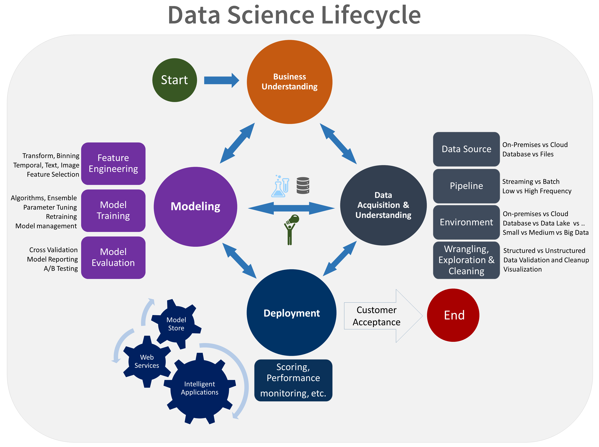

# Data Science Collected Resources

Welcome! This repository is a curated collection of resources and links related to data science, covering software, platforms, languages, techniques, and more.

**The primary and most comprehensive list of resources can be found in the `docs/index.md` file.** You can navigate to it directly [by clicking here](./docs/index.md).

## Progress Tracking

The resources in `docs/index.md` were intended to be formatted with checkboxes (Markdown task lists) to allow you to track your reading progress. For example:

- [ ] Resource A
- [x] Resource B (Completed)

Due to technical issues during automated processing, the full list in `docs/index.md` has not yet been updated with these checkboxes. However, you can manually edit it or use the example below as a template.

### Example: Artificial Intelligence Related

Here's a small sample of how items can be tracked:

- [ ] [MONTRÉAL.AI ACADEMY: ARTIFICIAL INTELLIGENCE 101 FIRST WORLD-CLASS OVERVIEW OF AI FOR ALL](http://www.montreal.ai/ai4all.pdf)
- [ ] [OpenAI blog](https://openai.com/blog)
- [ ] [AI thinks like a corporation—and that’s worrying - Open Voices](https://www.economist.com/open-future/2018/11/26/ai-thinks-like-a-corporation-and-thats-worrying)
- [ ] [AITopics](https://aitopics.org/search)

For the complete list of resources, please see [`docs/index.md`](./docs/index.md).

---

### Maintained By

Dr. Tirthajyoti Sarkar
*   [LinkedIn](https://www.linkedin.com/in/tirthajyoti-sarkar-2127aa7/)
*   [Medium](https://medium.com/@tirthajyoti)
*   [Tutorial-style Machine Learning Jupyter notebooks on GitHub](https://github.com/tirthajyoti/Machine-Learning-with-Python)
